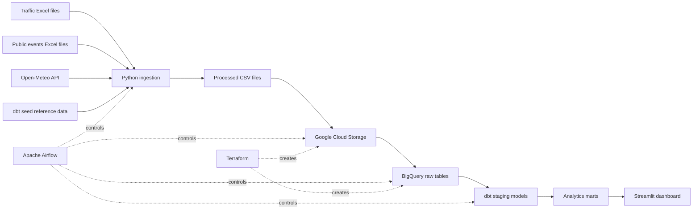
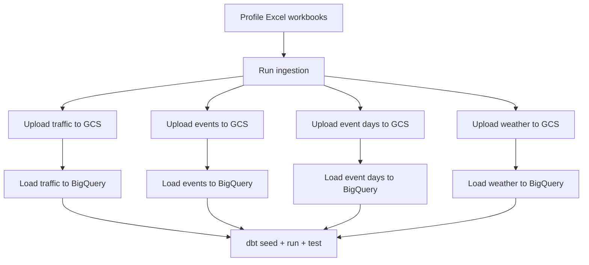

MASAR | مسار

<p align="center">
  
</p>

<p align="center">
  A data platform for vehicle movement in Saudi industrial cities.
</p>

<p align="center">
  <strong>Airflow · Python · Google Cloud Storage · BigQuery · dbt · Streamlit · Terraform · Docker</strong>
</p>

---

## About the project

**MASAR** studies vehicle movement in Saudi industrial cities. It combines traffic files, public-sector events, daily weather data, and city reference data.

The project reads Excel files, cleans and checks the data, uploads the results to Google Cloud, builds analytics tables in BigQuery with dbt, and shows the results in an interactive Streamlit dashboard.

> Weather and events are shown as context only. Six months of data cannot prove that they caused changes in vehicle movement.

<p align="center">
  
</p>

## Main features

- An interactive dashboard for **12 industrial cities** in **5 regions**.
- A comparison of average monthly movement between Q1 and Q2.
- An interactive map with city locations, total movement, and growth.
- Entry, exit, and entry/exit ratio analysis.
- Data-quality flags for unusual or repeated values.
- Missing months are shown as missing. They are not changed to zero.
- Public events are linked to industrial cities by city and region rules.
- Daily weather data is prepared as monthly context.
- The full system can run locally with Docker Compose.
- Terraform can create the required Google Cloud resources.

## Architecture



### Pipeline flow



## Technology

| Layer | Tool | Purpose |
|---|---|---|
| Local environment | Docker Compose | Runs Airflow, PostgreSQL, and Streamlit |
| Workflow | Apache Airflow 3 | Runs and monitors the data pipeline |
| Data preparation | Python and pandas | Reads, cleans, and checks Excel data |
| Raw storage | Google Cloud Storage | Stores clean files before loading |
| Data warehouse | BigQuery | Stores raw and analytics tables |
| Data models | dbt | Builds and tests staging and mart models |
| Dashboard | Streamlit, Plotly, and Folium | Shows charts, tables, and the map |
| Infrastructure | Terraform | Creates and manages Google Cloud resources |
| Airflow database | PostgreSQL | Stores Airflow metadata |

## Project structure

```text
MASAR/
├── airflow/
│   ├── dags/                 # The masar_core_pipeline DAG
│   ├── scripts/              # Excel workbook checks
│   └── MASAR_AIRFLOW_SETUP.md
├── ingestion/               # Traffic, events, and weather preparation
├── dbt/
│   ├── models/staging/       # Clean and standard data
│   ├── models/marts/         # Analytics tables for the dashboard
│   └── seeds/                # Cities, regions, and event rules
├── streamlit/
│   ├── app.py                # Dashboard application
│   ├── data_source.py        # BigQuery, local, and snapshot loading
│   ├── metrics.py            # Dashboard calculations
│   ├── theme.py              # Dashboard design
│   └── assets/               # Logos, maps, and images
├── terraform/               # GCS, BigQuery, and service account
├── data/processed/           # Generated local files; not stored in Git
├── scripts/check-project.ps1
├── docker-compose.yml
└── *.xlsx                    # Original source files
```

## Data sources

| Source | Period | Use |
|---|---|---|
| `Traffic (4).xlsx` | Q1 2026 | Monthly vehicle entries and exits |
| `Traffic (3).xlsx` | Q2 2026 | Monthly vehicle entries and exits |
| `Public Sector Events Q1 2026.xlsx` | Q1 2026 | Approved public-sector events |
| `Public Sector Events Q2 2026.xlsx` | Q2 2026 | Approved public-sector events |
| Open-Meteo Archive API | Jan–Jun 2026 | Temperature, rain, and wind |
| dbt seeds | Reference data | Cities, regions, coordinates, and event rules |

## Ingestion output

The ingestion step writes UTF-8 files to `data/processed/`.

| File | One row means |
|---|---|
| `traffic_monthly_clean.csv` | One industrial city in one month |
| `traffic_rejects.csv` | One rejected traffic row and its reason |
| `traffic_coverage.csv` | Data coverage for one city and month |
| `traffic_sheet_log.csv` | One Excel sheet that was checked |
| `events_clean.csv` | One public-sector event |
| `event_days.csv` | One event, industrial city, and day |
| `events_rejects.csv` | One rejected event and its reason |
| `events_sheet_log.csv` | One event sheet that was checked |
| `weather_daily.csv` | One industrial city and day |

## Data-quality rules

- Invalid rows are not removed without a record. They go to a reject file with a reason.
- Missing months stay empty. They are not changed to zero or estimated.
- `entry_exit_imbalance` means entries and exits differ by more than 30%.
- `repeated_previous_month_values` means the values are the same as the previous month.
- If only entries or only exits are available, the other value stays `NULL`.
- Q1 to Q2 growth uses **average monthly movement** for cities with data in both quarters.
- `source_file` and `source_row` help users check a value in the original file.

## Quick start with Docker

### Requirements

- Docker Desktop with a recent version of Docker Compose.
- At least 4 GB of memory for Docker is recommended.
- PowerShell on Windows.
- Access to the Google Cloud project for cloud features.

### 1. Create the environment file

```powershell
Copy-Item .env.example .env
```

Change the PostgreSQL password in `.env` before you share or publish the environment.

### 2. Sign in to Google Cloud

```powershell
gcloud config set project saudi-industrial-mobility
gcloud auth application-default login
```

On Windows, Docker reads the local gcloud settings from `%APPDATA%\gcloud`.

### 3. Build and start the services

```powershell
docker compose build
docker compose up airflow-init
docker compose up -d
```

Open these pages:

- Airflow: <http://localhost:8080>
- Streamlit: <http://localhost:8501>

In Airflow, run the DAG named `masar_core_pipeline`.

### 4. Stop the services

```powershell
docker compose down
```

To stop the services and delete the local Airflow database volume:

```powershell
docker compose down -v
```

> The second command deletes local Airflow and PostgreSQL metadata.

## Run ingestion without Docker

```powershell
python -m venv .venv
.venv\Scripts\Activate.ps1
pip install -r ingestion/requirements.txt

# Check the Excel file structure
python -m ingestion.inspect_excel

# Run traffic and events only
python -m ingestion.run --skip-weather

# Run traffic, events, and weather
python -m ingestion.run
```

## Run dbt manually

```powershell
docker compose run --rm airflow-cli bash -lc "cd /opt/airflow/project/dbt && dbt seed --profiles-dir . && dbt run --profiles-dir . && dbt test --profiles-dir ."
```

Main output models:

- `fct_city_movement_monthly`
- `fct_city_weather_daily`
- `fct_events`
- `dataset_summary`

## Run Streamlit only

### With Docker

```powershell
docker compose up -d --build streamlit
```

### With Python

```powershell
Set-Location streamlit
pip install -r requirements.txt
streamlit run app.py
```

### Choose a data source

The dashboard reads the `MASAR_DATA_SOURCE` variable.

| Value | Action |
|---|---|
| `auto` | Tries BigQuery, then local files, then a snapshot |
| `bigquery` | Reads only from BigQuery |
| `local` | Reads from `data/processed/` |
| `snapshot` | Reads from the included snapshot when available |

Example:

```powershell
$env:MASAR_DATA_SOURCE = "local"
streamlit run app.py
```

## Dashboard content

The dashboard includes:

- KPIs for total movement, busiest city, busiest region, entry/exit ratio, and temperature.
- Key findings created from the current data.
- An interactive Leaflet map for industrial cities.
- Monthly movement trends by region.
- A city comparison with a log-scale option.
- Q1 to Q2 growth analysis.
- Data-quality and missing-month reports.
- Weather and public-event context.
- A city-month table with a CSV download.
- A page that explains the pipeline and data sources.

## Terraform

Terraform manages these resources in `me-central1`:

- A GCS bucket with versioning and no public access.
- BigQuery datasets: `masar_raw`, `masar_staging`, and `masar_marts`.
- A service account named `masar-pipeline`.
- Required BigQuery and Cloud Storage roles.

```powershell
Set-Location terraform
Copy-Item terraform.tfvars.example terraform.tfvars
terraform init
terraform fmt
terraform validate
terraform plan
```

Always review the Terraform plan before you run `terraform apply`.

## Tests and checks

```powershell
# Run the project tests from the project root
python -m pytest -v

# Run the Streamlit metric tests
Set-Location streamlit
python -m pytest tests -v

# Check Docker Compose and Terraform formatting
Set-Location ..
.\scripts\check-project.ps1
```

## Useful commands

```powershell
# Show service status
docker compose ps

# Follow Airflow scheduler logs
docker compose logs -f airflow-scheduler

# Follow Streamlit logs
docker compose logs -f streamlit

# Rebuild Streamlit after code or asset changes
docker compose up -d --build streamlit

# Check the Compose file
docker compose config --quiet
```

## Troubleshooting

### The browser shows `ERR_ADDRESS_INVALID`

`0.0.0.0:8501` is the address used inside the container. Open this address in your browser:

```text
http://localhost:8501
```

### Streamlit changes do not appear

Rebuild the Streamlit image:

```powershell
docker compose up -d --build streamlit
```

Then refresh the browser with `Ctrl + Shift + R`.

### BigQuery does not connect

```powershell
gcloud auth application-default login
docker compose restart streamlit airflow-scheduler airflow-dag-processor
```

Also check that your account has access to the Google Cloud project.

### Airflow cannot connect to PostgreSQL

```powershell
docker compose ps
docker compose logs postgres
docker compose logs airflow-api-server
```

Check that the PostgreSQL values in `.env` are correct.

## Security

Do not upload these files to Git:

- `.env`
- `dbt/gcp-key.json`
- Service-account JSON files or other secret keys.
- `terraform.tfvars` and Terraform state files.
- Generated files in `data/processed/`.
- Local Airflow logs.

Each developer should use their own Application Default Credentials.

## Current limits

- The current analysis covers January to June 2026.
- BigQuery loads use `WRITE_TRUNCATE`, so each successful load replaces the table data.
- The pipeline does not skip Excel files that have not changed.
- Some cities do not have data for every month, so they cannot all be compared between Q1 and Q2.
- Weather and events are context, not proof of a cause.

## More documentation

- [Airflow setup and troubleshooting](airflow/MASAR_AIRFLOW_SETUP.md)
- [Airflow DAG details](airflow/README.md)
- [Ingestion details](ingestion/README.md)
- [Streamlit dashboard details](streamlit/README.md)
- [Terraform details](terraform/README.md)
- [Excel workbook inspection](docs/excel_inspection.md)

---

<p align="center">
  <strong>MASAR · Saudi Industrial Mobility Intelligence</strong>
</p>
