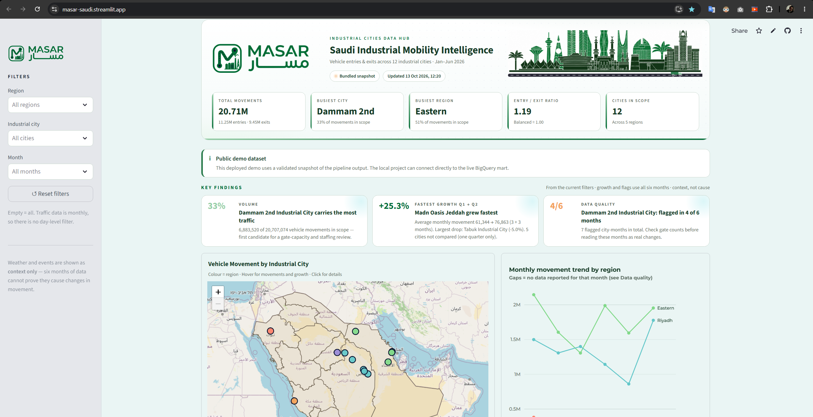
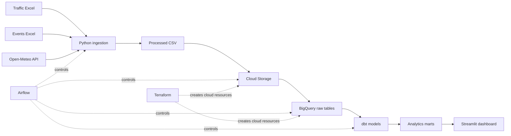
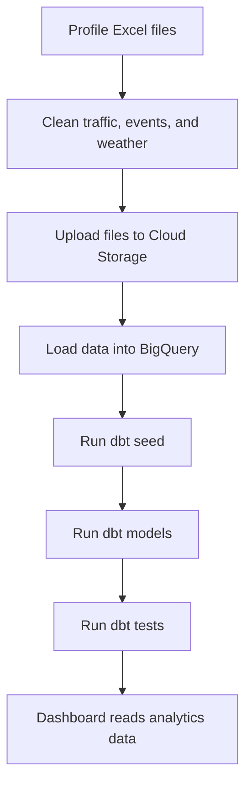

<div align="center">
  
</p>


  **A data platform for vehicle movement in Saudi industrial cities.**
[Live Demo](https://masar-saudi.streamlit.app/)


  [](https://www.python.org/)
  [](https://airflow.apache.org/)
  [](https://www.getdbt.com/)
  [](https://cloud.google.com/bigquery)
  [](https://streamlit.io/)
  [](https://www.terraform.io/)
  [](https://www.docker.com/)

</div>

---

## 📖 Overview

MASAR combines vehicle traffic, public-sector events, weather, and city reference data in one pipeline. It cleans Excel files, loads the data into Google Cloud, builds analytics tables with dbt, and shows the results in a Streamlit dashboard.

The current analysis covers 12 Saudi industrial cities from January to June 2026.

## ✨ Main Features

- Compare vehicle entries and exits by city, region, and month.
- Measure average monthly growth from Q1 to Q2.
- Explore industrial cities on an interactive Saudi map.
- Find missing months and unusual entry/exit values.
- View weather and public events as extra context.
- Read from BigQuery, local CSV files, or a saved snapshot.
- Run the full project with Docker Compose.

## 🖥️ Dashboard Preview

The dashboard shows the main KPIs, city movement, regional trends, and the interactive map. [Open the live demo](https://masar-saudi.streamlit.app/).

<p align="center">
  <a href="https://masar-saudi.streamlit.app/">
    
  </a>
</p>


## 🏗️ Architecture



### 🔄 Pipeline Flow



## 🧰 Technology

| Tool | Use |
|---|---|
| Python and pandas | Read, clean, and check source data |
| Apache Airflow | Run and monitor the pipeline |
| Google Cloud Storage | Store processed files |
| BigQuery | Store raw and analytics tables |
| dbt | Build and test data models |
| Streamlit, Plotly, and Folium | Build the dashboard and map |
| Terraform | Create Google Cloud resources |
| Docker Compose | Run the project locally |
| PostgreSQL | Store Airflow metadata |

## 🗃️ Data Sources

| Source | Period | Use |
|---|---|---|
| `Traffic (4).xlsx` | Q1 2026 | Monthly vehicle entries and exits |
| `Traffic (3).xlsx` | Q2 2026 | Monthly vehicle entries and exits |
| `Public Sector Events Q1 2026.xlsx` | Q1 2026 | Approved public-sector events |
| `Public Sector Events Q2 2026.xlsx` | Q2 2026 | Approved public-sector events |
| Open-Meteo Archive API | Jan–Jun 2026 | Daily weather data |
| dbt seeds | Reference data | Cities, regions, coordinates, and event rules |

## 🚀 Environment Setup

### ✅ Requirements

- Docker Desktop with Docker Compose.
- At least 4 GB of memory for Docker is recommended.
- PowerShell on Windows.
- Google Cloud access for cloud services.

> **Security:** Never upload `.env`, Google Cloud credentials, service-account keys, or Terraform state files to GitHub.

### ▶️ Start the Project

```powershell
Copy-Item .env.example .env

gcloud config set project saudi-industrial-mobility
gcloud auth application-default login

docker compose build
docker compose up airflow-init
docker compose up -d
```


Run the `masar_core_pipeline` DAG from Airflow.

### ⏹️ Stop the Project

```powershell
docker compose down
```

### 🔨 Rebuild the Dashboard

```powershell
docker compose up -d --build streamlit
```

## 🧪 Tests & Validation

Run the tests from the project root:

```powershell
python -m pip install -r ingestion/requirements.txt
python -m pytest tests -v
```

## 📚 Operations & Decisions

- [Runbook](docs/runbook.md): debugging, safe reruns, recovery steps, credential rotation, and teardown.
- [Architecture decisions](docs/decisions/): BigQuery, mart location, growth calculation, dashboard data sources, and full-refresh loads.

## 📂 Repository Structure

```text
MASAR/
├── airflow/              # Airflow DAG and setup files
├── ingestion/            # Traffic, events, and weather cleaning
├── dbt/
│   ├── models/staging/   # Clean and standard models
│   ├── models/marts/     # Analytics tables
│   └── seeds/            # Cities, regions, and event rules
├── streamlit/            # Dashboard, metrics, theme, and assets
├── terraform/            # Google Cloud infrastructure
├── data/processed/       # Generated local output
├── scripts/              # Project check scripts
├── docker-compose.yml
└── *.xlsx                # Source files
```
