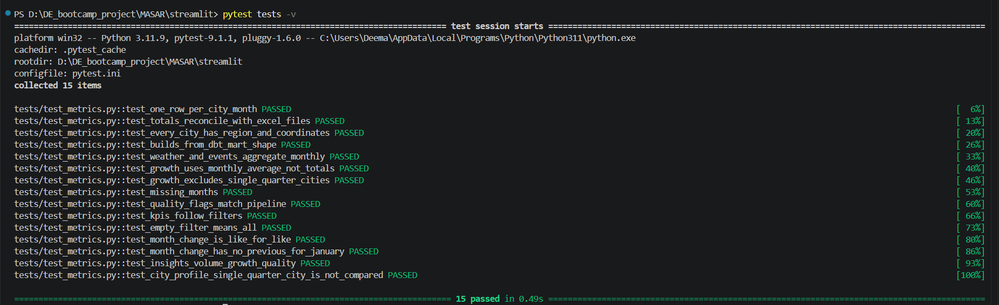
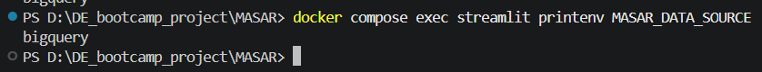

# Masar dashboard (Streamlit) — SDA-21

Answers the Operations Manager's questions on vehicle movement across Saudi industrial cities (Jan–Jun 2026).
Light theme: mint and white surfaces, charcoal text, coral accent, Saudi-green logo and landmark skyline.

## Proof it works

**Dashboard reading the live BigQuery mart** (`masar_staging.fct_city_movement_monthly`, total 20,707,074 = sum of both traffic files)


**All 15 tests pass** — run from the `streamlit` folder with `pytest tests -v`



**Docker container is forced to BigQuery** — no silent fallback (`docker compose exec streamlit printenv MASAR_DATA_SOURCE`)



## What's on the page

**Overview**
- KPI cards: total movements, busiest city, busiest region, entry/exit ratio, temperature (or cities in scope); pick one month to see the change vs the month before (like-for-like cities only)
- Key findings: volume, fastest growth Q1 → Q2, data quality — written from the data
- City profile when one city is selected (totals, growth, month coverage, flags)
- Interactive Saudi map (Folium) — marker = industrial city, colour = region; hover for movements and growth, click for details
- Monthly movement trend by region
- City comparison bars (with a log-scale toggle for small cities)
- Weather context and government events cards (context, not cause)

**Tabs**
- Growth Q1 → Q2 (average monthly movement, cities in both quarters only)
- Regions & entries vs exits
- Data quality (entry/exit ratio heatmap, flagged city-months, missing months)
- Weather & events by month
- Data table (+ CSV download)
- Pipeline & sources (pipeline stage diagram + where each number comes from)

Filters: region, industrial city, month, with a Reset filters button.

## Where the data comes from

| `MASAR_DATA_SOURCE` | Reads |
|---|---|
| `auto` (code default) | BigQuery → else local files → else bundled snapshot. The page says which one it used |
| `bigquery` | dbt mart `fct_city_movement_monthly` + `fct_city_weather_daily` and `stg_event_days` (falls back to `masar_raw.weather_daily` / `event_days`), quality flags from `masar_raw.traffic_monthly` |
| `local` | `data/processed/*.csv` written by `python -m ingestion.run` |
| `snapshot` | `snapshot/city_month_snapshot.csv` (traffic + events, built from the pipeline output) |

**Which source runs where**

| Where | `MASAR_DATA_SOURCE` | Why |
|---|---|---|
| Docker (`docker compose`, demo) | `bigquery` | Live mart only. If BigQuery is unreachable the page shows a clear error, no silent fallback |
| Public demo (masar-saudi.streamlit.app) | `auto` → BigQuery | Read-only service account (`masar-dashboard-reader`) in Streamlit secrets. Falls back to the snapshot if the secret is missing |
| Local `streamlit run` | `auto` | Anyone without credentials can still open the dashboard; the header shows when it is not live |

City → region and coordinates come from `dbt/seeds/industrial_cities.csv` and `regions.csv`.

| Variable | Default |
|---|---|
| `MASAR_BQ_MART` | `saudi-industrial-mobility.masar_staging.fct_city_movement_monthly` |
| `MASAR_BQ_RAW_DATASET` | `saudi-industrial-mobility.masar_raw` |
| `MASAR_PROJECT_DIR` | the repo root |

> The dbt profile writes models to `masar_staging`, so the mart is there (not in `masar_marts`).
> If that changes, set `MASAR_BQ_MART`.

## Run locally

```powershell
cd streamlit
pip install -r requirements.txt
streamlit run app.py
```

For BigQuery: `gcloud auth application-default login`, then `$env:MASAR_DATA_SOURCE="bigquery"`.

## Run with Docker

From the repo root (copy `.env.example` to `.env` first if you don't have one):

```powershell
docker compose up -d --build streamlit
docker compose exec streamlit printenv MASAR_DATA_SOURCE   # → bigquery
```

Open http://localhost:8501 — the header shows **Live BigQuery**.
Needs `gcloud auth application-default login` on the host (credentials are mounted read-only into the container).
Stop with `docker compose down`.

## Tests

```powershell
cd streamlit
pip install pytest
pytest tests -q        # 15 tests, incl. totals = 20,707,074 (sum of both traffic files)
```

## Design decisions

- **Growth = average monthly movement per quarter**, not totals — Tabuk misses April, Sudair April and May.
- **Entry/exit ratio is a quality indicator**, flagged with the same 30% rule as the ingestion `quality_flag`.
- **Missing months are gaps**, never filled in.
- **Weather and events are context only** — six months of data cannot show causation.
- **No mock-up numbers** — the proposal prototype values (e.g. 8.87M) are not used anywhere.
- **Colour follows the entity** — each region keeps its colour under any filter; palette checked for colour-blind safety on the light background.